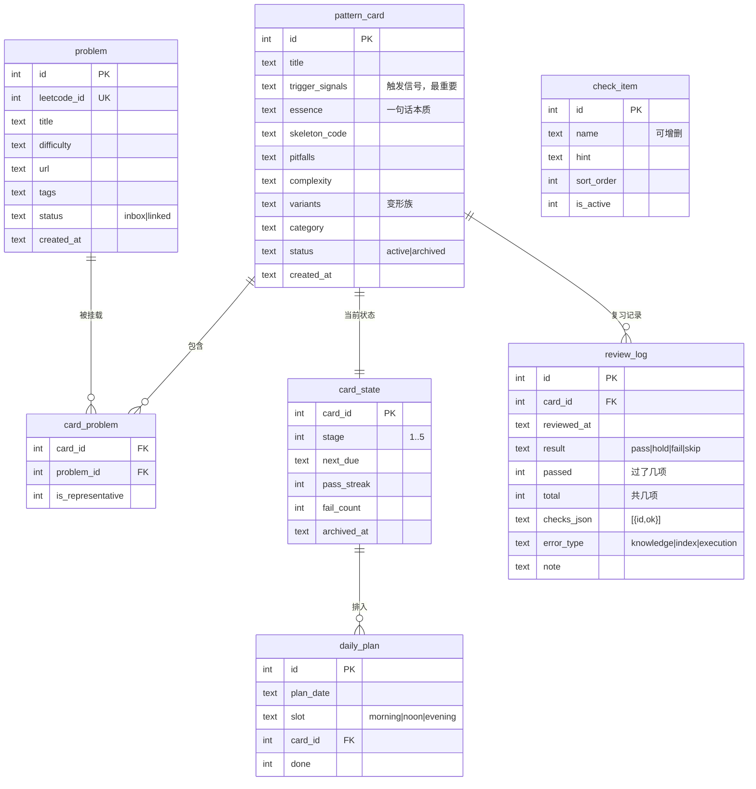

# 刷题调度 · 需求规格（v0.2 已拍板）

> v0.2 变更（2026-10-30 饲主拍板）：

| # | 决策 | 影响 |
|---|---|---|
| 1 | 界面 = **本地网页** | Flask + 单页前端 |
| 2 | 数据根 = `D:\MyNote\SelfNote\算法题目` | 必须支持整体搬迁到任意盘而不报错 |
| 3 | 队列上限 / 每日题量 **全部可调** | 写进 settings 表，改完即时生效 |
| 4 | 五检**抽象成一个可配置的检验项集合** | 新增 `check_item` 表；判定改用**通过率**，不再写死"5 检过 4" |
| 5 | 不做代码编辑器，**保留 API 扩展点** | 预留 `POST /api/run` 位置，MVP 不实现 |
| 6 | 名字 = **刷题调度** | exe / 快捷方式 / 窗口标题 / 数据目录统一用这个名字 |

> 原文（v0.1）保留在 §3 之后的正文，作为设计依据。

---

## 0. 一句话定位

一个**管题型卡而不是管题**的本地复习调度器：每天告诉你"今天该复习哪几张卡"，并强迫你闭卷证明自己会，然后自动把卡推到下一个到期日，直到归档出池。

**不做的事**：不判题、不写题解、不统计 AC 数、不搞连续打卡、不联网社交。

---

## 1. 从旧方法反推出的硬约束

| 旧方法的病 | 软件必须提供的机制 |
|---|---|
| 复习池只进不出，越积越多 | 在途上限 + 归档出池，双向闸门 |
| "再做一遍"没有终点 | 卡片状态机：stage 1→5，满档归档 |
| 看着答案写过程 → 假掌握 | 复习页默认**遮住答案**，强制三阶段展开 |
| 不知道哪天该复习谁 | 到期日由系统算，用户不判断 |
| 题是散的，没有题型 | 卡片为复习单位，题挂卡上 |
| 归纳总被推迟 | 独立的归纳工作台 + 待归卡区上限 |

---

## 2. 核心概念

| 概念 | 定义 | 一句话 |
|---|---|---|
| **题（problem）** | LeetCode 上的一道题 | 素材 |
| **题型卡（pattern_card）** | 一个可复用的解题模式：触发信号 + 骨架 + 边界 + 变体族 | **复习对象** |
| **在途卡（active）** | 未归档、参与调度的卡 | 队列里的 |
| **待归卡区（inbox）** | 已录入但还没挂到任何卡上的题 | 散题缓冲区 |
| **归档（archived）** | 连续通过 5 档后离开队列 | 出池 |

复习单位是卡，不是题。一道题可以只是某张卡的一个"证据"。

---

## 3. 功能需求（P0 = MVP 必须有）

### 3.1 调度引擎（P0）

- **FR-1 到期计算**：`next_due = 上次复习日 + interval[stage]`，`interval = [1, 3, 7, 15, 30]`
- **FR-2 状态迁移**（见 §6 状态机）
  - 五检得分 ≥ 4 → `stage += 1`，按新档排期
  - 得分 = 3 → 卡在原地，`next_due = 明天`（给一次机会）
  - 得分 ≤ 2 → `stage = max(1, stage-1)`，`next_due = 明天`
  - `stage` 已是 5 且通过 → **归档**
- **FR-3 双闸门**
  - 在途卡 ≤ **30**（默认，可配）→ 达到后今日新题配额强制归零
  - 待归卡区 ≤ **20** → 达到后禁止录新题，只能去归纳
- **FR-4 每日配额分配**
  - 早班：2 道新题（来自待归卡区，取最早录入）
  - 午班：2 张到期卡（按逾期天数降序）
  - 晚班：1 张到期卡，**口述模式**（只显示卡，不写码）
  - 到期卡多于配额：剩余顺延，看板显示"积压 N 张"警告
- **FR-5 跳过**：允许跳过，但记 `skip`，不顺延也不升档（不惩罚，但计入"按时率"统计）

### 3.2 复习流程（P0）

**FR-6 三阶段强制展开**（这是防假掌握的核心）

```
阶段一 屏：只显示「触发信号 + 代表题号」      ← 你现在必须自己回忆
    ↓ 点「我想起来了」
阶段二 屏：显示「骨架代码 + 边界坑」
    ↓ 逐项打勾
阶段三 屏：五检面板 + 结果判定
```

- **FR-7 五检项**（默认勾 3 项即可判定，全部可选）
  1. 冷启动：不看书能说出核心步骤
  2. 口述：3 分钟讲清"为什么这步不能省"
  3. 改条件：换个约束能自己修
  4. 抽骨架：写出不含题面细节的通用骨架
  5. 反向题：能指出一个错解错在哪
- **FR-8 记一笔**：每次复习写一行 `结果 + 错因 + 备注`，错因三选一：`不会 / 想不到 / 写错`
- **FR-9 计时**：正计时，只记录不限制；超 15 分钟提示"该跳过了"

### 3.3 题与卡管理（P0）

- **FR-10 录题**：手填题号 / 标题 / 难度 / 标签（V2 加自动抓取）
- **FR-11 建卡**：触发信号、一句话本质、骨架代码、边界坑、复杂度、变形族
- **FR-12 挂题**：一卡挂多题，标一个"代表题"
- **FR-13 卡库浏览**：按分类 / 状态 / stage / 到期筛选；查看单卡复习历史
- **FR-14 手动操作**：编辑、归档、回炉（归档卡打回 stage=3）、删除（二次确认）

### 3.4 归纳（P1，但结构 P0 就要留）

- **FR-15 归纳工作台**：本周未归卡的题列表 + 相似卡提示（同标签 / 触发信号关键词重合）
- **FR-16 合并卡**：两张卡并成一张，题全部迁移
- **FR-17 周提醒**：每周固定时段提示"该归纳了"（只提示，不强制）

### 3.5 统计（P1）

- **FR-18 四张图**：在途卡趋势、各档通过率、错因分布、按时率
- **FR-19 归档累计**：本月/总归档卡数（唯一值得看的"成绩"）

### 3.6 数据安全（P0）

- **FR-20 每日自动备份**：`backup/leetcode-YYYYMMDD.db`，保留 30 份
- **FR-21 导出**：全量 JSON + 卡片 Markdown（可直接进 Obsidian）
- **FR-22 导入**：JSON 回灌（换机迁移用）

---

## 4. 用户端操作清单

### 4.1 今日看板（打开软件第一眼）

| 操作 | 输入 | 输出 |
|---|---|---|
| 看状态 | — | 在途 12/30 · 待归卡 5/20 · 今日 2/5 |
| 开始复习 | 点某张卡 | 进复习页 |
| 跳过 | 点"跳过" | 记 skip，移出今日清单 |
| 提前看答案 | 点"我放弃了" | 记 fail，直接进阶段二（并计入错因） |
| 补录今日已做的题 | 点"+ 补记" | 手填一条复习记录 |

### 4.2 复习页（最高频，必须 3 次点击内完成一次）

| 操作 | 说明 |
|---|---|
| 回忆 | 只看到触发信号，自己在纸上/脑子里走一遍 |
| 展开 | 点开后看骨架和坑 |
| 打勾 | 五检任选 ≥3 项 |
| 判定 | 通过 / 挂 / 跳过 |
| 归因 | 挂的时候必须选错因（强制，不选不能提交） |
| 记一行 | 一句话，可空 |

### 4.3 录题页

| 操作 | 说明 |
|---|---|
| 输题号 | 支持 `1`、`two-sum`、完整 URL 三种 |
| 选卡 | 搜索已有卡 / 新建卡 / 暂不归卡（进 inbox） |
| 保存 | 进 inbox 或直接挂卡 |

### 4.4 卡库

| 操作 | 说明 |
|---|---|
| 筛选 | 分类、stage、是否到期、是否归档 |
| 编辑 | 改字段（触发信号最常改） |
| 看历史 | 这张卡的所有复习记录 + 错因分布 |
| 归档 / 回炉 | 手动干预状态机 |
| 删除 | 二次确认，软删除 |

### 4.5 设置

队列上限、每日配额（早/午/晚各几道）、间隔阶梯、数据目录、备份策略、导出。

---

## 5. 系统端：我要做的事

| # | 动作 | 产出 | 依赖 |
|---|---|---|---|
| E1 | 建隔离环境 | `venv/` + `requirements.txt` | Python 3.13.14（已确认） |
| E2 | 数据层 | `schema.sql` + 迁移（`PRAGMA user_version`） | sqlite 3.53.1（内置） |
| E3 | 调度引擎 | 纯函数：`due_cards() / allocate() / gate_check()` | 无 |
| E4 | 状态机 | `transition(card, score) -> new_state`（事务内） | E2 |
| E5 | HTTP API | 8-10 个端点（today / review / cards / problems / stats） | Flask |
| E6 | 前端 | 单页 5 个视图，原生 JS，无构建步骤 | 无 |
| E7 | 备份 | 启动时 + 每日一次的 `sqlite3.backup()` | — |
| E8 | 打包 | PyInstaller **onedir** → `dist/LeetCodeCoach/LeetCodeCoach.exe` | PyInstaller |
| E9 | 快捷方式 | 桌面 `LeetCode复习.lnk` 指向 exe，带图标 | 打包完成后 |
| E10 | 测试 | pytest 覆盖 E3/E4（调度错一个，整套就废） | — |
| E11 | 文档 | README / 使用手册 / CHANGELOG | — |

### 数据根：可搬迁是硬指标

数据根默认 `D:\MyNote\SelfNote\算法题目`，目录结构：

```
<数据根>/
  刷题调度.db          ← 全部结构化数据
  backup/              ← 每日自动备份，留 30 份
  cards/               ← 导出的 Markdown，Obsidian 直接读
```

指针文件 `data_root.txt` 放在程序目录旁，内容只有一行路径。定位顺序（任何一级失效就退到下一级，**绝不抛异常**）：

1. 环境变量 `SCJ_DATA_ROOT`
2. 程序目录 / `data_root.txt`
3. `%APPDATA%\刷题调度\data_root.txt`
4. 内置默认路径

搬到 E 盘的操作：设置页填新路径 → 点"迁移到此路径" → 自动复制 + 改指针。旧目录保留不删。因为路径只存在指针文件和配置里，代码里没有硬编码绝对路径，所以整个目录换盘不会崩。

### 技术选型说明

- **本地 Web（Flask + SQLite + 原生 JS）**，不是 tkinter。理由：这软件 80% 的复杂度在界面（看板/卡片编辑/三阶段展开/统计图），tkinter 做这些成本远高于 HTML。
- 固定 `127.0.0.1:8765` 起找端口，占用则 8766/8767 顺延；启动后自动开默认浏览器。
- 打包用 **onedir**（不是 onefile）：启动快、沙箱下不容易触发 EPERM（见旧账）。
- 预留扩展点：`POST /api/run`（本地跑样例判题）、`POST /api/leetcode/fetch`（抓题元数据）。MVP 只留路由占位，不实现。

---

## 6. 卡片状态机

```
        ┌──────────────────────────────────────────┐
        │                                          │
   [new] ──录卡──► [active stage=1]                │
                        │                         │
              复习通过(score≥4)                    │
                        ▼                         │
              stage 2 → 3 → 4 → 5                 │
                        │                         │
              stage=5 且通过                       │
                        ▼                         │
                   [archived] ──季度抽10%回炉──┘  (打回 stage=3)
                        
   复习挂(score≤2)：stage-1，next_due=+1
   复习平(score=3)：stage 不变，next_due=+1
```

`interval = [1, 3, 7, 15, 30]`，表示 **stage 1..5 各自的下次间隔（天）**。

---

## 7. 数据模型



**几个刻意的设计**：

- `trigger_signals` 是卡的第一字段，不是"题目分类"——因为考场上你靠它认题。
- **检验项是数据不是代码**（`check_item` 表）。用户可增删改名；判定用 `passed / total >= pass_threshold`，所以 3 项、5 项、8 项都能算，不用改逻辑。
- 判定四态：`pass / hold / fail / skip`。持平连续 `hold_limit` 次自动降档，避免长期卡死在同一档。
- `error_type` 三分类直接对应三种修法：补知识 / 改触发信号 / 加边界清单。
- `daily_plan` 单独存表，不做内存计算：这样"今天该复习什么"是确定的，跳过了明天还在。
- `card_problem` 允许 `pattern_card_id` 为空吗？不允许 —— 所有挂载都必须有卡，散题只能待在 `problem.status='inbox'`。

---

## 8. 分期

| 期 | 内容 | 验收标准 |
|---|---|---|
| **MVP（P0）** | 录题、建卡、调度、复习三阶段、五检、归档、备份、打包、桌面快捷方式 | 能连续用 7 天不崩、不加新功能 |
| V1.1（P1） | 统计四图、归纳工作台、JSON/MD 导出 | 每周归纳能在软件内完成 |
| V1.2 | LeetCode 元数据自动抓取（题号→标题/难度/标签） | 录题从 40 秒降到 5 秒 |
| V2 | 本地跑样例判题、Obsidian 双向同步 | ? 待评估 |

---

## 9. 决策记录

| # | 问题 | 决定 |
|---|---|---|
| 1 | 界面形态 | 本地网页（Flask + SQLite） |
| 2 | 数据放哪 | `D:\MyNote\SelfNote\算法题目`，且必须支持整体搬迁 |
| 3 | 30 / 5 道 | 全部进设置页，任意改，即时生效 |
| 4 | 待归卡区 | 保留，上限可配（默认 20） |
| 5 | 代码编辑器 | 不做，保留 `/api/run` 扩展点 |
| 6 | 名字 | 刷题调度 |
| 7 | GitHub | 见 §10 |

## 10. 开源与版本管理

- 本地 `git` 从一开始就建，每完成一个模块提交一次（按 `agent-coding-discipline` 的原子提交要求）。
- 远程仓库：**等 MVP 能跑通再推公开仓库**。理由：半成品公开仓库对简历是减分项，而私有仓库又没有备份以外的作用。
- 公开时按惯例做中英双语 README，`.gitignore` 必须挡住 `.venv/`、`dist/`、`build/`、`data/`、`*.db`——数据库里有个人复习记录，不能进仓库。
